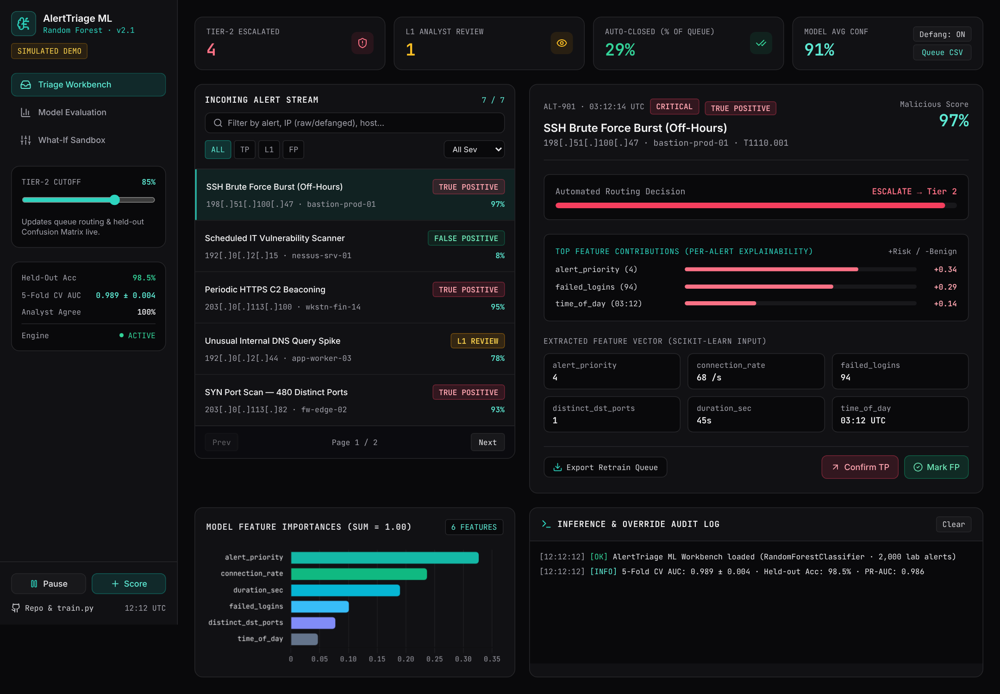
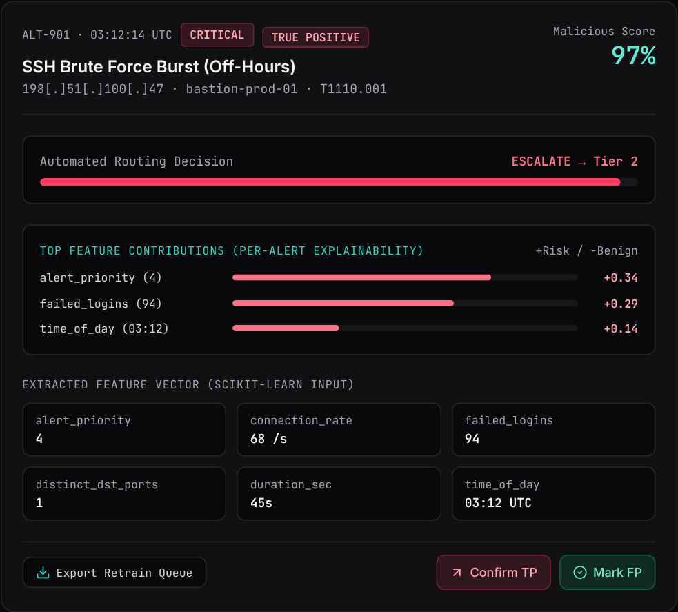
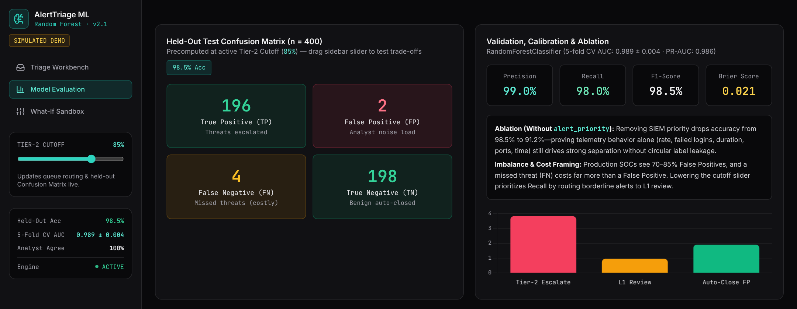
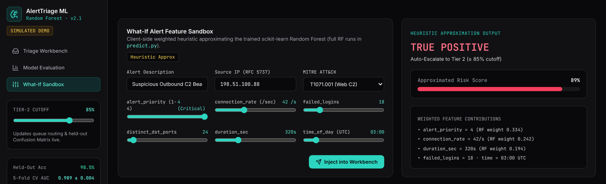
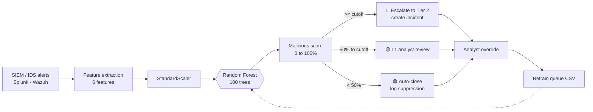

<div align="center">

# 🤖 AI-Powered SOC Alert Triage System

**ML-based false-positive reduction for SOC analysts, with a human-in-the-loop triage workbench**

*Random Forest · scikit-learn · Explainable Routing · Threshold-Tunable Escalation*


<br>



<sub>Triage Workbench: alert stream, per-alert explainability, routing decision, feature importances and audit log</sub>

</div>

---

## 📑 Table of Contents

[Overview](#-overview) · [Dashboard Tour](#%EF%B8%8F-dashboard-tour) · [Features](#-features) · [Pipeline](#%EF%B8%8F-pipeline) · [Model Performance](#-model-performance) · [Feature Engineering](#-feature-engineering) · [Setup](#%EF%B8%8F-setup) · [Limitations](#%EF%B8%8F-honest-limitations) · [Roadmap](#%EF%B8%8F-roadmap) · [Author](#-author)

---

## 📌 Overview

A large share of SOC alerts are false positives, and every one of them burns analyst time. This project trains a **Random Forest classifier** on alert telemetry to score each alert's malicious probability and route it automatically:

| Score band | Routing | Meaning |
|:---:|---|---|
| 🔴 **≥ Tier-2 cutoff** (default 85%) | Escalate → Tier 2 | High-confidence threat |
| 🟡 **50% – cutoff** | Route → L1 analyst queue | Borderline, needs human eyes |
| 🟢 **< 50%** | Auto-close + suppress | Likely benign noise |

The cutoff is **tunable (60–95%)**, so a SOC can trade analyst workload against missed threats. Analysts can **override** any verdict, and overrides can be exported as a **retraining queue**.

> ⚠️ **Demo notice:** The dashboard is a **simulated demo** running on a lab dataset of 2,000 synthetic alerts with RFC 5737 IPs. It makes no live calls. The What-If Sandbox is a client-side **heuristic approximation** of the model; the real scikit-learn Random Forest runs in `model/predict.py`.

### ✨ Headline Results

| Held-out accuracy | Precision | Recall | F1 | 5-fold CV AUC | PR-AUC |
|:---:|:---:|:---:|:---:|:---:|:---:|
| **98.5%** | **99.0%** | **98.0%** | **98.5%** | **0.989 ± 0.004** | **0.986** |

At the default 85% cutoff, **198 of 200 benign alerts (99%) were auto-closed**, while **196 of 200 threats (98%) were escalated** (n = 400 held-out alerts).

---

## 🖼️ Dashboard Tour

### 1️⃣ Triage Workbench
Master-detail view: filterable alert stream on the left, always-visible ML inspector on the right. KPI strip shows Tier-2 escalations, L1 queue, auto-close share and average model confidence.


### 2️⃣ Alert Inspector: Explainability & Human Override
Each alert shows its malicious score, the automated routing decision, the **top feature contributions (+risk / −benign)**, the exact feature vector fed to the model, and one-click **Confirm TP / Mark FP** overrides with a retrain-queue export.

<div align="center">

</div>

### 3️⃣ Model Evaluation (threshold-linked)
The confusion matrix, precision and recall **recompute live** when you drag the Tier-2 cutoff slider. This tab also reports calibration (Brier score), PR-AUC, an `alert_priority` ablation, and the cost framing behind the default cutoff.



### 4️⃣ What-If Sandbox
Dial in feature values (priority, connection rate, failed logins, ports, duration, hour), see an approximated risk score and routing verdict, then **inject the alert into the workbench** with a MITRE ATT&CK mapping.



---

## 🎯 Features

| | Feature | Description |
|:---:|---|---|
| 🌲 | **Random Forest Classifier** | 100-estimator ensemble trained on 2,000 labeled alerts (80/20 stratified split) |
| ⚡ | **Instant Triage** | Scores an alert with a malicious probability and routes it in milliseconds |
| 🎚️ | **Tunable Tier-2 Cutoff** | 60–95% slider re-routes the queue and recomputes the held-out confusion matrix live |
| 🔍 | **Per-Alert Explainability Panel** | Top feature contributions (+risk / −benign) next to every verdict (illustrative values; see [Roadmap](#%EF%B8%8F-roadmap)) |
| 📊 | **Feature Importances** | Six model features, importances sum to 1.00 |
| 🧪 | **Rigorous Evaluation View** | Confusion matrix, precision/recall/F1, 5-fold CV AUC, PR-AUC, Brier score, ablation |
| 🧑‍💻 | **Human-in-the-Loop** | Confirm TP / Mark FP overrides, Reset, **Analyst Agree** KPI, override persistence |
| 🔁 | **Retrain Queue Export** | Download analyst-corrected labels as CSV for the next training cycle |
| 🧭 | **MITRE ATT&CK Tagging** | Every alert carries a technique ID, selectable in the sandbox |
| 🛡️ | **Defang Toggle + Search** | Safe `[.]` IPs by default; search works on raw or defanged values |
| 📤 | **Queue CSV Export** | Formula-injection-safe CSV of the filtered queue |
| 🧾 | **Inference & Override Audit Log** | Live log of every scoring and analyst action |
| ♿ | **Accessible UI** | Keyboard-navigable alert cards, ARIA tab roles, live-region log, reduced-motion support |

---

## 🏗️ Pipeline



---

## 📁 Project Structure

```
ml-alert-triage/
├── data/
│   ├── generate_dataset.py      # Synthetic alert dataset generator
│   ├── alerts_dataset.csv       # 2,000 labeled alert samples
│   └── model_metrics.json       # Training results & feature importance
├── model/
│   ├── train.py                 # Model training + evaluation
│   ├── predict.py               # Real-time alert classification
│   ├── model.pkl                # Trained Random Forest model
│   └── scaler.pkl               # StandardScaler for normalization
├── dashboard/
│   └── index.html               # Interactive triage workbench (single file)
├── docs/
│   └── screenshots/             # Dashboard screenshots used in this README
├── main.py                      # Main orchestrator
├── requirements.txt
└── README.md
```

---

## 📊 Model Performance

Evaluated on a held-out, stratified test set of **400 alerts** (200 benign, 200 malicious) at the default **85% Tier-2 cutoff**.

<table>
<tr>
<td>

|  | Predicted TP | Predicted FP |
|---|:---:|:---:|
| **Actual TP** | ✅ **196** | ❌ 4 (missed) |
| **Actual FP** | ⚠️ 2 (noise) | ✅ **198** |

</td>
<td>

| Metric | Value |
|---|:---:|
| Accuracy | 98.5% |
| Precision | 99.0% |
| Recall | 98.0% |
| F1-score | 98.5% |
| 5-fold CV AUC | 0.989 ± 0.004 |
| PR-AUC | 0.986 |
| Brier score | 0.021 |

</td>
</tr>
</table>

<details>
<summary><b>📄 Per-class report at the 85% cutoff</b> (derived from the confusion matrix)</summary>

```
                precision    recall  f1-score   support
False Positive     0.980     0.990     0.985       200
 True Positive     0.990     0.980     0.985       200

      accuracy                         0.985       400
     macro avg     0.985     0.985     0.985       400
```
</details>

### 🎚️ Cutoff Trade-off (held-out, n = 400)

Lowering the cutoff catches more threats but sends more noise to analysts. A missed threat (FN) costs far more than a false positive, so SOCs usually favor recall.

| Tier-2 cutoff | TP | FP | FN | TN | Precision | Recall |
|:---:|:---:|:---:|:---:|:---:|:---:|:---:|
| 60% | 199 | 11 | 1 | 189 | 94.8% | 99.5% |
| 65% | 199 | 8 | 1 | 192 | 96.1% | 99.5% |
| 70% | 198 | 6 | 2 | 194 | 97.1% | 99.0% |
| 75% | 198 | 4 | 2 | 196 | 98.0% | 99.0% |
| 80% | 197 | 3 | 3 | 197 | 98.5% | 98.5% |
| **85% (default)** | **196** | **2** | **4** | **198** | **99.0%** | **98.0%** |
| 90% | 191 | 1 | 9 | 199 | 99.5% | 95.5% |
| 95% | 178 | 0 | 22 | 200 | 100.0% | 89.0% |

### 🧬 Ablation: Is `alert_priority` Doing All the Work?

`alert_priority` is the most important feature, which could mean the model just mirrors SIEM severity. **Removing it drops accuracy from 98.5% to 91.2%**, so behavioral telemetry (rate, failed logins, duration, ports, time) still carries strong signal on its own.

### 🌲 Feature Importances

```
alert_priority       ████████████████  0.334
connection_rate      ████████████      0.242
duration_sec         █████████         0.194
failed_logins        █████             0.103
distinct_dst_ports   ████              0.079
time_of_day          ██                0.048
                                       ─────
                                       1.000
```

---

## 🔬 Feature Engineering

| Feature | Description | Why it matters |
|---|---|---|
| `alert_priority` | SIEM-assigned priority (1–4) | High priority is more likely a true positive |
| `connection_rate` | Connections per second | Scanners and brute-forcers burst; beacons stay low and steady |
| `duration_sec` | Connection duration | C2 beacons and exfil hold long sessions |
| `failed_logins` | Authentication failures | Brute-force and credential-stuffing indicator |
| `distinct_dst_ports` | Unique destination ports | Port scans touch hundreds of ports |
| `time_of_day` | Hour the alert fired | Off-hours (e.g. 03:00 UTC) activity is more suspicious |

---

## ⚙️ Setup

```bash
git clone https://github.com/ibu-cyx0/AI-Powered-Threat-Detection-Engine
cd AI-Powered-Threat-Detection-Engine
pip install -r requirements.txt
python main.py                 # generate data, train, evaluate, write data/model_metrics.json
```

Then open the dashboard:

```
Open dashboard/index.html in your browser
```

> The dashboard loads Tailwind CSS, Chart.js and Lucide icons from public CDNs, so keep an internet connection on for the first load.

**Dashboard tips:** drag the **Tier-2 Cutoff** slider and watch the queue and the Model Evaluation tab update together. Use **Tab / Enter / Space** to navigate alert cards from the keyboard.

---

## ⚠️ Honest Limitations

Good ML write-ups say where the numbers stop being trustworthy:

- **Synthetic data.** The 2,000 alerts are generated, not collected from a production SOC. Treat the metrics as validation of the *pipeline*, not as production performance.
- **Balanced test set.** The 200/200 split is unrealistic; real queues are dominated by false positives (commonly 70–85%+). PR-AUC and the cutoff table help, but precision in production would be lower.
- **`alert_priority` dependence.** Mitigated, not eliminated, by the ablation above.
- **Sandbox is a heuristic.** The What-If Sandbox approximates the Random Forest in the browser; it does not execute the trained model.
- **Illustrative contributions.** Per-alert contribution values in the inspector are illustrative until TreeSHAP is wired in.

---

## 🗺️ Roadmap

- [ ] TreeSHAP explainability for every prediction (replace illustrative contributions)
- [ ] Run the exported trees in-browser (`m2cgen` / ONNX Runtime Web) so the sandbox uses the real model
- [ ] Probability calibration (`CalibratedClassifierCV`) with a reliability curve
- [ ] Evaluation on a public dataset (CICIDS2017 / UNSW-NB15) alongside the synthetic data
- [ ] Time-based and host-grouped splits to rule out leakage
- [ ] REST API endpoint for live alert ingestion
- [ ] Splunk alert webhook integration
- [ ] Email / Slack alert routing
- [ ] LSTM model for sequence-based anomaly detection

---

## 🛠️ Tech Stack

| Layer | Tools |
|---|---|
| **ML pipeline** | Python · scikit-learn (Random Forest, StandardScaler, cross-validation) |
| **Data** | pandas · numpy |
| **Dashboard** | HTML · Tailwind CSS · JavaScript · Chart.js · Lucide |
| **Detection context** | MITRE ATT&CK · Splunk / Wazuh alert sources |

---

## 👤 Author

**Mohamed Ibrahim H**  
EC-Council Certified SOC Analyst (CSA) · Splunk Core Certified User · Cisco Cyber Ops Associate

[](https://github.com/ibu-cyx0)
[](https://tryhackme.com/p/IbrahimCyb3r4)
[](https://ibrahim-cybrx.is-a.dev/)
[](mailto:ibrahim.cybrx@gmail.com)

---

<div align="center">

**MIT License** · Built for SOC Tier 1 / Tier 2 and CTI analyst workflows

</div>
